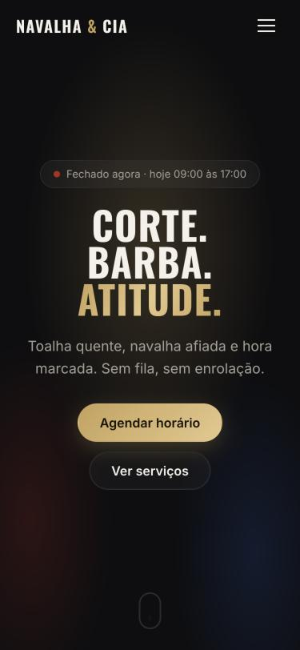
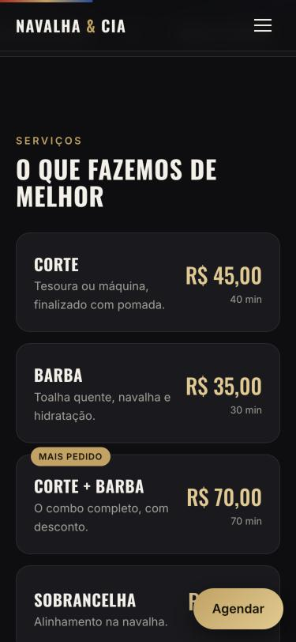
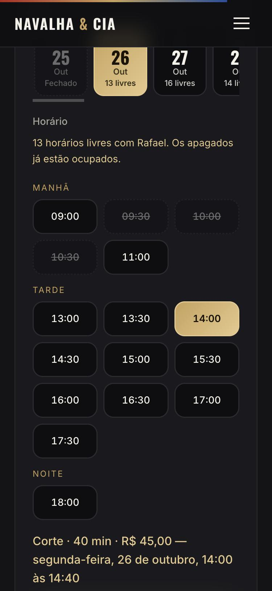

# Navalha & Cia — página de barbearia

Landing page de barbearia, mobile-first, em HTML + CSS + JavaScript puros (sem build, sem dependências).
Hospede em qualquer lugar (GitHub Pages, Netlify, Vercel) ou abra o `index.html` direto no navegador.

## Telas
| Abertura | Serviços | Agendamento |
|---|---|---|
|  |  |  |

## O que tem
- Abertura com poste de barbeiro animado e título que entra por etapas; o conteúdo se afasta conforme o scroll.
- Serviços com preço e duração, equipe, tabela de horários com o dia de hoje destacado e selo "Aberto agora".
- **Agendamento com horários livres:** o cliente escolhe serviço e barbeiro, toca em um dia (próximos 14 dias, com a quantidade de horários livres) e em um horário. Aparecem só opções que cabem: dentro do expediente, fora do almoço, depois de agora e **respeitando a duração do serviço**. Horários ocupados ficam riscados. Com barbeiro escolhido, valem as ocupações dele; sem preferência, o horário está livre se algum barbeiro estiver livre. O botão abre o **WhatsApp** com a mensagem pronta e a confirmação é feita pela barbearia.
- Barra de progresso, revelação ao rolar, menu mobile e botão flutuante "Agendar".
- Acessibilidade: botões de 48 px, rótulos reais, foco visível e `prefers-reduced-motion` respeitado.

## Personalizar
Tudo está no objeto `CONFIG`, no topo do `script.js`: nome, WhatsApp (só dígitos, com DDI e DDD), endereço, serviços, barbeiros, horários, intervalo entre horários e pausa de almoço.
As ocupações ficam em `agenda.json` (**dados de exemplo**): `fixos` repete por dia da semana e `reservas` vale para uma data. Para a página ler o arquivo, sirva por HTTP (GitHub Pages, `python3 -m http.server`); abrindo o `index.html` direto, ela mostra a agenda toda livre.
Para trocar cores, edite as variáveis no início do `style.css` (`--ouro`, `--bg`...).

## Decisões
- **Dia e horário em botões, não em campos livres (D1):** o cliente não digita um horário que não existe, e o barbeiro só recebe pedidos que cabem na agenda. A duração do serviço entra no cálculo, então um Corte + Barba (70 min) não aparece onde só cabem 40 min.
- **Disponibilidade vinda de `agenda.json` (D2):** sem backend, a página não sabe sozinha o que está ocupado. O arquivo é atualizado pela barbearia. **Limite conhecido:** dois clientes podem pedir o mesmo horário antes da barbearia atualizar o arquivo; a confirmação pelo WhatsApp resolve o conflito.
- **Sem backend:** uma barbearia pequena já confirma pelo WhatsApp; um sistema de agenda próprio só vale a pena quando houver volume.
- **Sem depoimentos nem números inventados:** a página não afirma o que não pode comprovar. Adicione avaliações reais quando existirem.
- **Sem fotos de terceiros:** o mapa e o visual são SVG/CSS. Troque por fotos reais da barbearia quando tiver.

- **Conteúdo nunca fica preso atrás de animação (D3):** as animações de entrada só escondem o conteúdo enquanto o JavaScript confirma que está funcionando. Se o script falhar (ou o navegador usar um `script.js` antigo em cache), depois de 2,5 s a página mostra tudo sem animação. Os arquivos de CSS e JS têm versão na URL (`?v=3`) para evitar cache velho; ao mudar um deles, aumente o número.

## Próximos passos
- Galeria com fotos reais dos trabalhos
- Agenda ao vivo: reservas gravadas em um banco, para o horário sumir assim que alguém reserva (ver o `cardapio-digital` como referência de Supabase + RLS)
- Avaliações reais e link do Instagram
